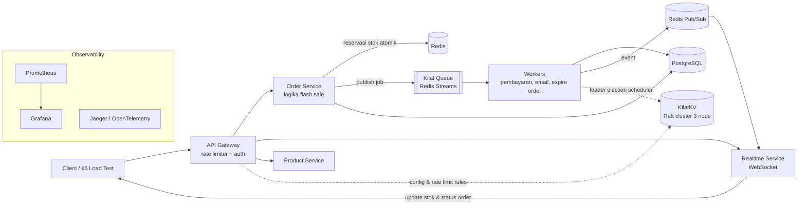

# ⚡ Kilat — Platform Flash Sale Terdistribusi

> Backend flash sale yang dirancang untuk menahan lonjakan ribuan request per detik **tanpa oversell**, dibangun dari beberapa service yang saling bekerja sama: API gateway, order service, job queue, real-time service, dan key-value store terdistribusi berbasis Raft.


---

## 📌 Daftar Isi

- [Latar Belakang](#-latar-belakang)
- [Arsitektur](#-arsitektur)
- [Komponen](#-komponen)
- [Tech Stack](#-tech-stack)
- [Keputusan Desain Penting](#-keputusan-desain-penting)
- [Struktur Repository](#-struktur-repository)
- [Menjalankan Secara Lokal](#-menjalankan-secara-lokal)
- [Contoh API](#-contoh-api)
- [Testing & Benchmark](#-testing--benchmark)
- [Observability](#-observability)
- [Roadmap](#-roadmap)
- [Apa yang Saya Pelajari](#-apa-yang-saya-pelajari)

---

## 🎯 Latar Belakang

Saat flash sale (misalnya promo 10.10 atau 12.12), ribuan user menekan tombol "Beli" di detik yang sama untuk stok yang sangat terbatas. Sistem backend biasa sering gagal dengan cara berikut:

| Masalah | Akibat |
|---|---|
| **Race condition** pada stok | Barang terjual melebihi stok (*oversell*) |
| Database kebanjiran query | Latency melonjak, server tumbang |
| Request duplikat (user klik berkali-kali) | Pesanan ganda, uang terpotong dua kali |
| Bot dan spam request | User asli kalah cepat |
| Proses berat dijalankan sinkron | Response lambat, timeout |

**Kilat** dibangun untuk menyelesaikan masalah-masalah tersebut, sekaligus menjadi tempat saya mempraktikkan konsep sistem terdistribusi secara langsung.

---

## 🏗️ Arsitektur



**Alur pembelian singkat:**

1. Request masuk lewat **Gateway** → dicek rate limit, token JWT, dan idempotency key.
2. **Order Service** mengurangi stok di Redis secara atomik (Lua script). Kalau stok habis, request langsung ditolak tanpa menyentuh database.
3. Kalau berhasil, pesanan dibuat dengan status `PENDING` dan job dikirim ke **Kilat Queue**.
4. **Worker** memproses pembayaran (simulasi), menyimpan ke PostgreSQL, lalu mengirim event.
5. **Realtime Service** mendorong update stok dan status pesanan ke semua client yang terhubung.
6. Pesanan yang tidak dibayar dalam batas waktu otomatis dibatalkan, dan stok dikembalikan.

---

## 🧩 Komponen

### 1. API Gateway + Rate Limiter (`services/gateway`)
Satu pintu masuk untuk semua service.
- Rate limiting dengan algoritma **token bucket** dan **sliding window** (per user dan per IP)
- Autentikasi JWT
- Reverse proxy dan routing ke service internal
- Response caching untuk endpoint yang sering diakses (detail produk)
- Aturan rate limit bisa diubah tanpa restart (dibaca dari KilatKV)

### 2. Order Service — Inti Flash Sale (`services/order`)
- Reservasi stok **atomik** di Redis menggunakan Lua script
- **Idempotency key** untuk mencegah pesanan ganda
- Database tetap menjadi *source of truth*; Redis berfungsi sebagai lapisan pertahanan pertama
- Rekonsiliasi berkala antara stok di Redis dan PostgreSQL

### 3. Kilat Queue — Job Queue Sendiri (`services/worker`, `pkg/queue`)
Implementasi job queue sendiri di atas Redis Streams (bukan memakai library jadi).
- Retry otomatis dengan **exponential backoff**
- Prioritas job (misalnya pembayaran lebih penting daripada email)
- **Dead-letter queue** untuk job yang gagal terus
- Job terjadwal (cron), misalnya membatalkan pesanan yang kedaluwarsa
- Jaminan **at-least-once delivery**, dengan handler yang idempotent

### 4. Realtime Service (`services/realtime`)
- Koneksi WebSocket untuk update stok secara langsung dan notifikasi status pesanan
- **Horizontal scaling**: beberapa instance tetap sinkron lewat Redis Pub/Sub
- Fitur chat sederhana antara pembeli dan customer service
- Heartbeat, reconnect otomatis, dan pengiriman ulang pesan yang terlewat

### 5. KilatKV — Key-Value Store Berbasis Raft (`services/kilatkv`)
Key-value store terdistribusi yang saya implementasikan sendiri dengan algoritma konsensus **Raft**.
- Leader election, log replication, dan snapshot
- Cluster 3 node yang tetap berjalan walaupun 1 node mati
- Dipakai untuk menyimpan konfigurasi dinamis (aturan rate limit, feature flag) dan leader election scheduler di worker
- Diuji dengan skenario kegagalan: node dimatikan, jaringan terputus (*network partition*)

---

## 🛠️ Tech Stack

Stack utama memakai **Go** karena performanya tinggi, concurrency-nya bawaan (goroutine), dan banyak dipakai di perusahaan tech untuk service berskala besar. Kolom alternatif disediakan kalau ingin membangun dengan bahasa lain.

| Kategori | Pilihan Utama | Alternatif |
|---|---|---|
| Bahasa | **Go 1.26** | Python (FastAPI), TypeScript (NestJS), Java (Spring Boot) |
| HTTP framework | Chi / Gin | FastAPI, Fastify |
| Komunikasi antar service | gRPC + Protocol Buffers | REST, NATS |
| Database | **PostgreSQL 16** | MySQL |
| Akses database | sqlc + pgx | GORM, SQLAlchemy, Prisma |
| Migrasi database | golang-migrate | Alembic, Flyway |
| Cache & stok | **Redis 7** (Lua script) | Dragonfly, KeyDB |
| Message queue | Redis Streams (Kilat Queue) | RabbitMQ, Kafka, NATS JetStream |
| Real-time | WebSocket (gorilla/websocket / coder/websocket) | Socket.IO |
| Konsensus | Raft (implementasi sendiri) | etcd, hashicorp/raft (sebagai pembanding) |
| Autentikasi | JWT | Paseto, OAuth2 |
| Containerization | **Docker + Docker Compose** | Podman |
| Orkestrasi (opsional) | Kubernetes (kind / k3d untuk lokal) | Docker Swarm |
| CI/CD | **GitHub Actions** | GitLab CI |
| Metrics | Prometheus + Grafana | Datadog |
| Tracing | OpenTelemetry + Jaeger | Zipkin, Grafana Tempo |
| Logging | slog (structured logging) + Loki | ELK Stack |
| Load testing | **k6** | Locust, Vegeta |
| Testing | testing + testify + testcontainers-go | pytest, Jest |
| Dokumentasi API | OpenAPI / Swagger | Postman Collection |

---

## 💡 Keputusan Desain Penting

### Kenapa stok dikurangi di Redis, bukan langsung di database?
Kalau 10.000 request langsung mengunci baris yang sama di PostgreSQL, database akan menjadi *bottleneck*. Dengan Lua script di Redis, pengecekan dan pengurangan stok terjadi dalam **satu operasi atomik** yang sangat cepat. Hanya request yang berhasil mendapat stok yang diteruskan ke database.

```lua
-- KEYS[1] = stock:{product_id}, ARGV[1] = jumlah
local stock = tonumber(redis.call("GET", KEYS[1]) or "0")
if stock >= tonumber(ARGV[1]) then
    redis.call("DECRBY", KEYS[1], ARGV[1])
    return 1  -- berhasil
end
return 0      -- stok habis
```

### Bagaimana kalau Redis mati?
PostgreSQL tetap menjadi *source of truth*. Saat Redis pulih, stok direkonsiliasi ulang dari database. Sebagai lapisan terakhir, database juga memiliki constraint `CHECK (stock >= 0)` supaya oversell mustahil terjadi walaupun ada bug di lapisan lain.

### Kenapa membuat job queue dan Raft sendiri?
Untuk sistem produksi, library yang sudah teruji memang pilihan yang lebih masuk akal. Di proyek ini saya sengaja mengimplementasikannya sendiri untuk memahami cara kerjanya dari dalam, lalu membandingkan hasilnya dengan solusi populer (misalnya KilatKV vs etcd) di bagian benchmark.

### Trade-off yang diambil
| Keputusan | Keuntungan | Kekurangan |
|---|---|---|
| Stok di Redis | Sangat cepat, mengurangi beban DB | Butuh rekonsiliasi, ada kompleksitas tambahan |
| At-least-once delivery | Tidak ada job yang hilang | Handler wajib idempotent |
| Raft 3 node | Tahan 1 node mati | Write lebih lambat karena butuh mayoritas |

> Catatan lengkap setiap keputusan ada di folder [`docs/adr/`](docs/adr/) (Architecture Decision Records).

---

## 📁 Struktur Repository

```
kilat/
├── services/
│   ├── gateway/        # API gateway + rate limiter
│   ├── order/          # logika flash sale
│   ├── product/        # data produk & stok
│   ├── worker/         # pemroses job
│   ├── realtime/       # WebSocket server
│   └── kilatkv/        # key-value store berbasis Raft
├── pkg/
│   ├── queue/          # library Kilat Queue
│   ├── ratelimit/      # algoritma rate limiting
│   └── observability/  # helper metrics, tracing, logging
├── proto/              # definisi gRPC
├── migrations/         # migrasi database
├── deploy/
│   ├── docker-compose.yml
│   ├── k8s/
│   └── grafana/        # dashboard siap pakai
├── loadtest/           # skrip k6
├── docs/
│   ├── adr/
│   └── images/
├── .github/workflows/  # pipeline CI/CD
├── Makefile
└── README.md
```

---

## 🚀 Menjalankan Secara Lokal

### Prasyarat
- Docker & Docker Compose
- Go 1.26+ (kalau ingin menjalankan tanpa Docker)
- Make (Windows: `choco install make` dari terminal Administrator)
- k6 (untuk load testing)

### Langkah

```bash
# 1. Clone repository
git clone https://github.com/<username>/kilat.git
cd kilat

# 2. Salin file environment
cp .env.example .env

# 3. Jalankan semua service
make up            # = docker compose -f deploy/docker-compose.yml up -d

# 4. Jalankan migrasi dan isi data contoh
make migrate
make seed

# 5. Cek apakah semua service sehat
make health
```

| Service | URL |
|---|---|
| Product Service (health check) | http://localhost:8081/healthz |
| API Gateway | http://localhost:8080 |
| Swagger UI | http://localhost:8080/docs |
| Grafana | http://localhost:3000 (admin / admin) |
| Jaeger | http://localhost:16686 |
| Prometheus | http://localhost:9090 |

---

## 📡 Contoh API

**Membuat pesanan flash sale**

```http
POST /api/v1/orders
Authorization: Bearer <token>
Idempotency-Key: 7f9c2b1e-4a3d-4e8f-9b2a-1c5d6e7f8a9b
Content-Type: application/json

{
  "product_id": "prd_123",
  "quantity": 1
}
```

**Respons berhasil**

```json
{
  "order_id": "ord_8f7a6b",
  "status": "PENDING",
  "expires_at": "2026-10-10T10:15:00Z"
}
```

**Respons lain yang mungkin muncul**

| Status | Arti |
|---|---|
| `201 Created` | Stok berhasil direservasi |
| `200 OK` | Request duplikat (idempotency key sama), mengembalikan pesanan sebelumnya |
| `409 Conflict` | Stok habis |
| `429 Too Many Requests` | Terkena rate limit |

**Berlangganan update real-time**

```
ws://localhost:8080/ws?product_id=prd_123
```

---

## 🧪 Testing & Benchmark

```bash
make test              # unit test
make test-integration  # integration test dengan testcontainers
make test-chaos        # skenario kegagalan KilatKV (node mati, network partition)
make loadtest          # load test flash sale dengan k6
```

### Hasil Benchmark

> Diisi setelah pengujian. Lingkungan uji: _(spesifikasi mesin)_

| Skenario | Target | Hasil |
|---|---|---|
| Request/detik di endpoint order | ≥ 5.000 RPS | _TBD_ |
| Latency p99 | < 200 ms | _TBD_ |
| Jumlah oversell (10.000 user, 100 stok) | **0** | _TBD_ |
| Waktu pemulihan KilatKV saat leader mati | < 2 detik | _TBD_ |
| Job hilang saat worker di-restart | **0** | _TBD_ |

---

## 📊 Observability

- **Metrics**: jumlah request, error rate, latency per endpoint, panjang antrian, stok tersisa
- **Tracing**: satu request bisa ditelusuri dari gateway sampai worker di Jaeger
- **Logging**: log terstruktur (JSON) yang membawa `trace_id` supaya mudah dicocokkan dengan trace
- Dashboard Grafana siap pakai tersedia di `deploy/grafana/`

---

## 🗺️ Roadmap

Proyek dibangun bertahap. Setiap fase menghasilkan sesuatu yang sudah bisa didemokan.

### Fase 1 — Fondasi Flash Sale
- [ ] Order service + product service (REST)
- [ ] PostgreSQL + migrasi
- [ ] Reservasi stok atomik di Redis
- [ ] Idempotency key
- [ ] Docker Compose
- [ ] Load test pertama dengan k6

### Fase 2 — Job Queue
- [ ] Library Kilat Queue di atas Redis Streams
- [ ] Retry + exponential backoff
- [ ] Dead-letter queue
- [ ] Job terjadwal untuk membatalkan pesanan kedaluwarsa

### Fase 3 — API Gateway
- [ ] Reverse proxy + routing
- [ ] Rate limiter (token bucket & sliding window)
- [ ] Autentikasi JWT
- [ ] Komunikasi antar service via gRPC

### Fase 4 — Real-time
- [ ] WebSocket untuk update stok dan status pesanan
- [ ] Scaling beberapa instance dengan Redis Pub/Sub
- [ ] Chat pembeli dan customer service

### Fase 5 — KilatKV (Raft)
- [ ] Leader election
- [ ] Log replication
- [ ] Snapshot & pemulihan
- [ ] Integrasi dengan gateway (config dinamis) dan worker (leader election)
- [ ] Chaos test

### Fase 6 — Production Readiness
- [ ] Prometheus + Grafana + Jaeger
- [ ] Pipeline CI/CD di GitHub Actions
- [ ] Deployment ke Kubernetes
- [ ] Benchmark lengkap + blog post teknis

---

## 📚 Apa yang Saya Pelajari

> Bagian ini diisi selama pengerjaan: masalah yang ditemui, bug yang paling sulit, dan apa yang akan saya lakukan berbeda kalau mengulang dari awal.

---

## 📖 Referensi

- *Designing Data-Intensive Applications* — Martin Kleppmann
- [In Search of an Understandable Consensus Algorithm (Raft paper)](https://raft.github.io/raft.pdf)
- [MIT 6.5840 Distributed Systems](https://pdos.csail.mit.edu/6.824/)
- [Redis Streams Documentation](https://redis.io/docs/latest/develop/data-types/streams/)

---

## 📄 Lisensi

MIT License — lihat [LICENSE](LICENSE).
